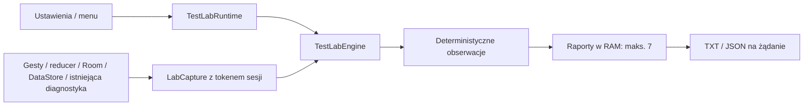

# Zavro TestLab v1165 — specyfikacja pomiarów

Baza: v1164 `d890c68bd15d0f79e25ccd2935fb64ee955286b8`. Jeden silnik, siedem trybów, lokalny pomiar podczas działań użytkownika. Tester nie otwiera kart, nie grupuje ich i nie steruje filmem.

## Czas i lifecycle

- PREPARING → RUNNING → FINALIZING → COMPLETED; możliwe PARTIAL, CANCELLED, FAILED.
- Odliczanie 3 s zaczyna się w rzeczywistym oknie Browser/MPV. Ustawienia nie dostarczają klatek do raportu. Przy braku odpowiedniego Activity przygotowanie nie podtrzymuje cyklicznego timera.
- Pomiar: 60 000 ms według `SystemClock.elapsedRealtimeNanos`, niezależnie od zegara ściennego. Czas bez odpowiedniego Window jest jawny. Bez wake locka. Opóźnienie dostarczenia deadline/cleanup jest oddzielnym `finalizationDelayMs`.
- Token sesji i operacji odrzuca stare callbacki. Zakończenie zamyka zapis, odłącza Window/listenery, anuluje i łączy zadanie próbnika, usuwa recovery, następnie publikuje raport.
- Rotacja nie zmienia sesji. Settings wraca przez RESULT_OK i zamknięcie Activity; nie wysyła nowego Intent do BrowserActivity i nie odtwarza BrowserFragment/mini MPV.
- Wspólna bramka wyklucza nakładanie z istniejącym Supertestem 40 s. Jego czas i dotychczasowe kopiowanie pozostają zachowane.

## Metryki i rzeczywiste źródła

| Metryka | Źródło i jednostka | Zakres / ograniczenie |
|---|---|---|
| Klatki UI, jank | JankStats 1.0.0, frameDurationUiNanos | Przypięte Activity/Window paneli/FAB. Suma klatek Window, nie unikalne klatki ekranu ani FPS |
| CPU klatki | FrameDataApi24.frameDurationCpuNanos, ms | Wartość JankStats; osobno od CPU procesu |
| Przekroczenie budżetu | FrameDataApi31.frameOverrunNanos, ms | Wartości ujemne dozwolone; brak źródła = null/status |
| Odświeżanie | Display.refreshRate, Hz | Jank klasyfikuje biblioteka; brak sztywnego progu 16,7 ms |
| Operacje | START / ACCEPT / CANCEL / FINISH, względne ns | Panel: rzeczywisty DOWN, próg zatwierdzenia, pierwszy widoczny pre-draw. Nieznany początek nie produkuje zerowej latencji |
| Toolbar | Istniejący AnimatorEnd/Cancel | Bez dodatkowego animatora. Osobno pasek główny i pomocnicze |
| Karty / profile | Stan po reducerze BrowserStore | Brak dispatchu z obserwatora; parentId nie implikuje grupowania |
| Grupy | Po zakończeniu transakcji Room | Readback tylko zmienionych grup podczas testu; brak karty w częściowej sesji nie jest podstawą kasowania danych |
| Kolejność | Wynik DataStore.edit i publikacja | Zapis weryfikowany po zakończeniu; serializacja pozostaje na dispatcherze DataStore |
| Java / native heap | Runtime / Debug, bajty | Niezależne wartości i delty; jedna próbka nie daje delty |
| PSS / USS | Debug.MemoryInfo, KiB × 1024 | Wyłącznie własny proces; nie sumować z heapem ani ze sobą |
| CPU procesu | Process.getElapsedCpuTime, ms / elapsed ns | Średnia ważona czasem, % jednego rdzenia, może >100%. Nie obejmuje podprocesów Gecko |
| Heartbeat ACK | Jedna wiadomość Main, opóźnienie ns | Tylko odpowiednie okno na pierwszym planie; epoch usuwa stare pomiary |
| Wiek oczekującej wiadomości | elapsed czas od wysłania, osobna metryka | Obserwacja także przed ACK; nie jest ANR. Generacja foreground odrzuca stary kontekst |
| Bateria / thermal / power save | Systemowe API Androida | Bez precyzyjnej energii aplikacji; brak danych = null |
| Historia zakończeń | ApplicationExitInfo API 30+, reason/status | Własny proces; bez description, traceStream, PID lub nazw procesów w raporcie. Nie jest awarią w bieżących 60 s |
| Gecko | Reducer loading/progress/URL + RequestInterceptor | LOAD_COMPLETE nie dowodzi płynności kompozytora. Błąd wiązany z rzeczywistym EngineSession |
| Wideo / handoff | Istniejące allowlisty trace/discovery | Tylko kody i liczniki; bez nowych skanów, JNI odczytów, poleceń lub audio focus |
| Pozycja / prędkość MPV | Istniejące callbacki właściwości | Przyrosty ≤5 s oddzielone od nieciągłości. FILE_LOADED nie dowodzi PLAYBACK_STARTED; pauza nie daje postępu |
| Lua / DSP | Delty istniejących liczników dla tego samego ownera | Brak kodu, etykiet, ID przycisków i prywatnych skryptów |

Gecko compositor, klatki SurfaceView/MPV, dokładna energia, oba tory audio, klatki PopupWindow menu i koniec systemowej animacji okna mają jawne NOT_EXPOSED_BY_PLATFORM. FIRST_PREDRAW potwierdza układ, nie koniec animacji ani prezentację filmu. Źródłowe zdarzenie fullscreen nie zastępuje pre-draw.

ACK korelujemy z właścicielem i jedną oczekującą próbą. Bez identyfikatora żądania nakładające się prepare mają UNKNOWN, bez pozornej latencji/sukcesu. Nie są automatycznie uznawane za błąd aplikacji.

## Agregacja i limity

- Histogram klatek: 4096 kubełków po 0,25 ms, obejmuje wszystkie poprawne próbki. Percentyle są górną granicą kubełka. Overflow nie daje pozornie dokładnego percentyla.
- Minimum próbek: P50 ≥2, P90 ≥10, P95 ≥20, P99 ≥100. Średnia i maksimum obejmują wszystkie poprawne próbki.
- Latencja operacji: wyłącznie pomyślne próby o znanym początku, histogram 1 ms; P95 od 20 próbek. Anulowanie jest odrębnym wynikiem.
- Timeline ≤1024 wpisów; budżet 64/s kompleksowy, 128/s specjalistyczny. Agregaty obejmują odrzucone szczegóły. Liczba evicted/dropped jest jawna.
- ≤128 aktywnych operacji, ≤32 markerów/obserwacji, ≤180 próbek zasobów. Baseline i ekstrema pamięci są niezależne od wyparcia próbek.
- JankStats kopiuje wyłącznie prymitywy. Nie przechowuje FrameData ani listy states; zwykła klatka nie tworzy rekordu Kotlin i nie zapisuje na dysk.
- OS próbnik co 1 s; PSS/USS co 5 s lub 2 s w RESOURCES. Jeden oczekujący heartbeat. Licznik zmienia tekst tylko przy zmianie wartości.
- Tagowanie operacji jest korelacją. Kilka tagów nie powiela globalnej klatki; nie wolno sumować ich jako osobnych klatek ekranu.

## Analizator

Bez punktowego wskaźnika zdrowia. Pierwszeństwo ma CONFIRMED_INVARIANT_FAILURE z porównania danych po operacji. OBSERVED_PERFORMANCE_ANOMALY potwierdza pomiar, nie przyczynę. SUSPECTED_CORRELATION wymaga niezależnego odtworzenia. Brak próby / za mało próbek pozostaje jawny.

Jawne progi heurystyczne: UI/panele 250 ms, karty 1000 ms, Gecko 5000 ms, wideo 3000 ms; skorelowana długa klatka 100 ms; wzrost pamięci 16 MiB. To progi diagnostyczne, nie gwarancje responsywności telefonu. Wzrost pamięci w 60 s nie dowodzi wycieku, ACK nie dowodzi stanu obu torów audio. CANCELLED nie wchodzi do wolnych sukcesów. Każda obserwacja ma kod, jednostkę, dostępny czas, próg i liczbę wspierających próbek.

## Prywatność, recovery i eksport

Wyłącznie zamknięte enum i ograniczone liczby PRZED zapisem. Bez URL, hostów/IP, tokenów, cookies, nagłówków, tytułów, nazw/ID profili i kart, formularzy, ścieżek, kodu skryptów ani Throwable. Opaque owner służy wyłącznie chwilowej korelacji; cleanup usuwa mapy/weak refs.

Raporty domyślnie RAM, najwyżej 7 ostatnich trybów. Recovery jest oddzielnym opt-in OFF: AtomicFile w noBackupFilesDir, ≤64 KiB, ostatnie 64 zdarzenia, najwyżej raz/5 s. Generacja blokuje stare zapisy. Retencja 24 h sprawdzana przy odczycie; normalne zakończenie usuwa plik. Nie podmieniamy uncaught exception handlera.

TXT i wersjonowany JSON schemaVersion 1 korzystają z tego samego przyciętego snapshotu; każdy ≤256 KiB UTF-8. Obcięcie usuwa starsze szczegóły i nie zmienia agregatów. Marker odwołuje się tylko do zachowanych zdarzeń. Brak danych to null/status.

Clipboard, SAF i FileProvider uruchamia wyłącznie użytkownik. Pending SAF przechowuje dokładnie żądany raport w ViewModel: obrót nie przełącza go na nowszy, utrata procesu nie eksportuje przypadkowego raportu. Sharecache: ≤2 unikalne pliki, READ grant, retencja 24 h przy następnym otwarciu; usunięcie cofa URI grants. Brak zewnętrznej telemetrii.

## Weryfikacja i ograniczenia

Testy Kotlin/JUnit, Room/DataStore, JS integralności, Lua i FFmpeg są odrębne od Android UI. Mikroprofil JVM dotyczy tylko agregatora, nie narzutu JankStats/OS/telefonu. Porównanie emulatora używa kontrolowanego workloadu; nie dowodzi osiągów Nothing Phone (1). Systemowe gesty, realne strony, słuchowa ocena audio i ciągłość mini/fullscreen wymagają fizycznego telefonu. Stan wykonania i linki CI są w handoffie oraz CODEX_RESUME_V1165.md.
