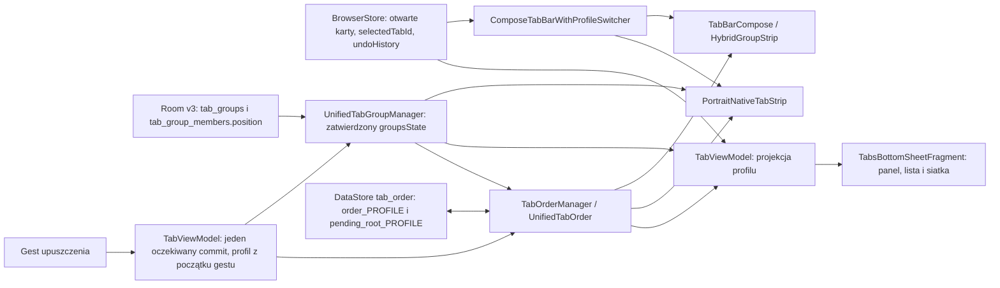

# Zavro x MPV v1159 — karty, grupy, panel i paski

Data: 2026-10-25, Europe/Warsaw. Baza: `09f708ee981d255c4bf9d649f60b2137a1181416`, potwierdzone v1158, Draft PR #71. Gałąź: `fix/zavro-x-mpv-v1159-tabs-groups-toolbar-audit`. Bez merge; normalna aplikacja Zavro bez zmian. Wykonanie i review przez jednego autora, bez subagentów.

## Źródła prawdy i rzeczywiste ścieżki

- **Otwarte karty i aktywna karta:** Mozilla `BrowserStore`, nie Room. Zamykanie używa `TabsUseCases`; `UndoMiddleware` zachowuje ID i stan do Undo. Widoki zawsze przecinają metadane grup z aktualnymi kartami danego profilu/prywatności.
- **Grupy i członkostwo oraz kolejność wewnątrz grupy:** Room v3. Cache managera jest projekcją zatwierdzonej transakcji. `TabGroupMember.position` jest zapisywany gęsto i odczytywany według pozycji. Identyfikator grupy jest wspólny z DataStore.
- **Kolejność kontenerów grup i kart solo:** `UnifiedTabOrder.primaryOrder`, zapis `tab_order/order_<profile>`. Przeplatanie grupa → solo → grupa → solo pozostaje zachowane. Kopia `tabIds` w JSON nie może nadpisywać Room przy zwykłym przestawieniu kontenerów.
- **Zwinięcie:** `UnifiedTabOrder.isExpanded` jest odczytywane przez wszystkie paski; istniejący Room `isCollapsed` jest ustawiany na ten sam stan dla zgodności pozostałych odbiorców. Nie ma niezależnego, niezapisywanego stanu w pasku pionowym.
- **Panel:** `TabsBottomSheetFragment.CompactSideTabs` czyta zatwierdzone `groupsState`, kolejność i widoczny profil VM. Lista/siatka używają `UnifiedItemBuilder`. Usuniętego nagłówka nie wskrzesza unia z opóźnionym cache VM.
- **Poziom:** `ComposeTabBarWithProfileSwitcher` → `TabBarCompose`; kanoniczna projekcja kolejności korzysta z aktualnego Room. `HybridGroupStrip` jest aktywnym widokiem wybranej grupy/chipów; chipy przestrzegają kolejności kontenerów, liczby wynikają z żywych członków.
- **Pion:** przy dolnym pasku aktywny jest `PortraitNativeTabStrip`; dostaje te same Room i DataStore. Także wybierak kart respektuje kolejność użytkownika. Poziom nadal korzysta z Compose.
- **Drag:** `UnifiedDragSystem` wykrywa gest, rejestruje cele i rysuje podgląd. Nie jest właścicielem danych. Każda powierzchnia deleguje do oczekiwanej operacji VM; nie uruchamia sekwencji osobnych jobs remove/add/reorder z opóźnieniami.
- **Przyciski adresu:** `UnifiedToolbar.addBrowserActionsToAddressBar`, istniejące `UserPreferences.niraToolbarActionOrder`, `niraToolbarActionSlotDp`, `niraAddressMinWidthDp`. Przenoszone są te same View z ich listenerami; nie rekonstruuje się ikon/akcji według nowych indeksów.
- **Paski i viewport:** `BrowserFragment` tworzy `UnifiedToolbar`, który używa `ModernToolbarSystem`; przewijanie TOP jest podpięte do Gecko, `ModernScrollBehavior` nie dubluje tego toru. Oddzielny dolny pasek nie jest dzieckiem animowanego górnego kontenera. Istniejących animacji, fullscreen/mini i marginesów Gecko nie przebudowano.
- **Zmiana profilu:** filtrowane stany Store → host/VM; poprzednie listy są zerowane przed zawieszalnym odczytem nowego profilu. Kolektory Compose są dziećmi efektu, a ręcznie utworzone ViewModele mają `ViewModelStore.clear()` przy zakończeniu ich właściciela. Publikacja singletona sprawdza aktualny profil.

Zbadano różnice #36/v1123 i #37/v1124: utrzymano wspólny porządek, Room jako pozycje członków i współrzędne względem root/listy. Naprawiono pozostałe wyścigi i indeksy; nie przywrócono kumulowania lokalnych delt ani wieloetapowych zapisów z `delay(50/100)`.

## Potwierdzone błędy i poprawki

| Priorytet | Dowód / objaw | Przyczyna i wdrożona poprawka |
|---|---|---|
| P0 | Równoczesne dodanie 10 kart zachowało tylko `[t0,t10]` | Niezablokowane read/modify/write cache na IO. Serializacja całej mutacji, jedna transakcja Room i publikacja po commit. |
| P0 | Wymuszony błąd SQLite po przeniesieniu usuwał kartę ze źródła | Osobne transakcje remove/add. Zewnętrzna transakcja obejmuje źródło, cel, pozycje i cache; wyjątek przywraca cache. |
| P0 | Opóźniony zapis A zastępował widoczny porządek B | Singleton publikował po zawieszeniu bez weryfikacji profilu; read/modify/write nie były serializowane. Operacje są serializowane, zapisy pozostają pod własnym kluczem, publikacja jest ograniczona do aktywnego profilu. |
| P0 | Pusta przejściowa lista podczas restore usuwała zapisane pozycje i resetowała zwinięcie | Odtwarzanie było traktowane jak definitywne zamknięcie. Rekoncyliacja zachowuje nieobecne sloty i przecina je z żywym Store dopiero przy renderowaniu. Test obejmuje faktyczne zamknięcie i ponowne otwarcie pliku DataStore. |
| P0 | `contextId=private` z `content.private=false` | `ProfileMiddleware` zmieniał tylko etykietę. Ustawia także rzeczywistą flagę prywatności używaną przez silnik. |
| P0 | Migracja do prywatnego/nazwanego profilu ponownie wiązała stary `EngineSession` | Zmiana etykiety nie przenosi istniejącego Gecko do innej partycji. Jawna migracja zachowuje ID i metadane UI, odłącza stary kontekst przez zwykłe usunięcie, tworzy świeży `EngineState` i usuwa obcy parentId. Strona przy takim przeniesieniu przeładowuje się. Zwykłe przełączanie profili nie wykonuje tej operacji. |
| P0 | Przeniesienie do domyślnego profilu wracało do aktywnego B | Jawne `null` było traktowane jako brak kontekstu. Istniejące oznaczenie guest/default jest ustawiane przed re-add. Guard synchronicznej migracji zapobiega także nadpisywaniu Undo i ponownemu automatycznemu grupowaniu. |
| P1 | Szybkie otwarcie 10 jawnie powiązanych linków tworzyło 10 grup | Równoczesna decyzja o braku grupy rodzica. Decyzja i utworzenie/rozszerzenie grupy są jedną serializowaną mutacją. Brak wnioskowania z selectedTabId. Middleware czyta stan karty po przetworzeniu profilu. |
| P1 | Lista/siatka gubiła świeżego członka lub pokazywała go solo | Używała starej kopii tabIds w JSON. `UnifiedItemBuilder` bierze członków i pozycje z Room; dodaje świeżo zatwierdzone grupy i deduplikuje. |
| P1 | Klik nagłówka w poziomie przełączał grupę dwukrotnie; pion nie zapisywał zwinięcia | Dwa callbacki i osobny lokalny set. Jeden callback i wspólne, zapisane isExpanded; natywny View testuje klik oraz aktualizację. |
| P1 | Obserwatory starego profilu/arkusza mogły nadal zapisywać stan | `flowScoped` tworzył niezależny zakres wewnątrz LaunchedEffect; ręczny VM nie był czyszczony. Zwykłe `flow().collect` w zakresie efektu i jawne właścicielstwo VM; badge korzysta z cyklu życia widoku. |
| P1 | Upuszczenie poza listą wybierało najbliższy wiersz | Brak walidacji viewportu. Sprawdzane są obie osie i wartości niefinitywne. Anulowanie/obrót/zmiana profilu nie zatwierdza starego gestu. |
| P1 | Uchwyt przeciągania przesuwał cel o własne przesunięcie względem wiersza | Współrzędne uchwytu dodawano do początku wiersza. Wiersz i uchwyt mają własne początki root; geometria upuszczenia używa offsetów przewiniętej listy. |
| P1 | Ostatni ruch w oknie 16 ms zatwierdzał poprzedni cel | Target UI był debouncowany i nie przeliczany przy release. Końcowy target jest wyznaczany ponownie z ostatniej pozycji palca. Regresja wykazała `[b,a,c]` zamiast `[b,c,a]`. |
| P1 | Boczne nagłówki grup nie obsługiwały przenoszenia grup | Dodano long press nagłówka i względne przestawienie stabilnych ID we wspólnym managerze, bez nowego systemu kolejności. |
| P1 | Utworzenie grupy na karcie solo przesuwało ją za kolejny kontener | Indeks celu pochodził sprzed usunięcia źródła. Nowa grupa otrzymuje UUID przed transakcją i trwały zamiar względem stabilnej następnej kotwicy; ten sam mechanizm odtwarza pozycję po przerwaniu. |
| P1 | Drag w prawo pomijał wskazany przycisk/slot | Używano indeksu sprzed usunięcia przenoszonego elementu. Jeden przelicznik granicy wstawiania obsługuje wszystkie kierunki; test przechodzi wszystkie granice dla każdego elementu. |
| P1 | Callback profilu przekazywał guest/default karty do nazwanego profilu | Warunek null nie sprawdzał profilu domyślnego. Poprawiono filtrowanie, a host dodatkowo niezależnie waliduje przekazaną listę. |
| P1 | Przeniesienie grupy do profilu zmieniało sam kontekst grupy | Najpierw migrowane są jej rzeczywiste karty, potem Room weryfikuje docelowy kontekst wszystkich członków. Jawne null/default jest obsługiwane, a stare sloty przeniesionych ID są usuwane wyłącznie z profilu źródłowego. |

P2: nie wprowadzano zmian kosmetycznych. Niezależne ryzyka i ograniczenia poniżej nie są przedstawiane jako testowo potwierdzone crashe.

## Room i DataStore przy przerwaniu operacji

Room pozostaje źródłem członkostwa; DataStore nie zapisuje go z powrotem przy przestawieniu kontenerów. Zmiana źródła/celu w Room jest atomowa. W operacji wyjmującej kartę na poziom główny lub grupującej na karcie docelowej zapis `pending_root_<profile>` poprzedza zmianę Room i zawiera wyłącznie stabilne ID/stronę docelowego elementu. Rekoncyliacja odczytuje Room: jeżeli źródło nadal jest w grupie, operacja nie została zatwierdzona; po zatwierdzonym odłączeniu odtwarza docelowy slot. Zapis finalnego `order_<profile>` i usunięcie zamiaru są pojedynczym edit DataStore. Brak odtwarzania komend medialnych i sztucznych opóźnień.

Nie dodano migracji Room, destrukcyjnego fallback ani resetowania preferencji. Nazwy bazy, DataStore i istniejące klucze ustawień są niezmienione. Zamknięte/jeszcze nieodtworzone ID mogą pozostawać jako metadane do Undo/restore; nie są renderowane ani liczone jako otwarte. Automatyczne trwałe odśmiecanie takich ID po wygaśnięciu odzyskiwania pozostawiono bez zmian: nie wprowadzono kasowania na podstawie chwilowej pustej listy. To konserwatywna retencja metadanych, nie dowód pełnego sprzątania wszystkich historycznych rekordów.

## Panel i toolbary

Panel: kompaktowa lista, favicon/fallback, tytuł, zamykanie, menu, żywe liczniki, grupy, zwijanie i podgląd drag zachowane. Autoscroll ma jeden job związany z klatkami, ograniczoną prędkość i działa tylko wewnątrz krawędzi viewportu. Szerokości portrait/landscape, zakresy i ich klucze zachowano; otwarty panel pobiera właściwą szerokość po obrocie. Nie dodano warstw przechwytujących dotyk.

Przyciski: zachowano format zapisanej kolejności i suwaki szerokości. Przeniesienie przenosi istniejący View z właściwym listenerem. Istniejący algorytm ograniczania drugorzędnych przycisków pozostawia menu; nie dodano resetu konfiguracji. Fizyczny układ, insets i dostępność menu na małej szerokości wymagają telefonu.

Górny pasek, `ModernToolbarSystem`, `ModernScrollBehavior` i `BrowserFragment` nie wymagają nowego animatora ani zmiany toru MPV. Istniejący niezależny dolny kontener pozostaje poza minimalizacją TOP. Fullscreen/IME/mini i obrót są ocenione statycznie oraz przez zachowane regresje; bez urządzenia nie są oznaczone jako zweryfikowane wizualnie.

## Walidacja i macierz

Końcowe JUnit: **230/230 PASS**, failures/errors/skips 0, w tym **36 nowych testów** kart/profili/grup. Zachowane testy MPV/audio:194. JS: **162/162 PASS** (159 istniejących i3 nowe kontrole integralności/wydania). Systemowe Lua: **77/77 PASS** (17bridge +15client +33DRC/DE +12environment); FFmpeg DSP: **28/28 PASS** (13dotychczasowych +15DRC/DE). **Końcowy Gradle PASS, BUILD SUCCESSFUL 4m41s**: `testDebugUnitTest lintDebug assembleDebug compileDebugAndroidTestKotlin --offline --console=plain --max-workers=1`. Pierwszy pełny cold build9m21s zakończył się sukcesem przed ostatnimi poprawkami review; końcowy przebieg obejmuje finalny kod. Po jego sukcesie nie uruchamiano dodatkowej kompilacji. Testy RED → GREEN udokumentowano w przebiegach lokalnych: współbieżność/rollback, profil po zawieszeniu, partial restore, geometria i indeksy, rzeczywisty drop, przerwanie między magazynami, prywatność i migracja sesji, końcowy release target.

| Obszar | Automatyczna weryfikacja | Android/telefon |
|---|---|---|
| Karty solo, grupy 1/wiele, interleaving, lista/siatka | Kotlin: rzeczywiste wyniki projekcji, bez szukania nazw funkcji | Gesty NIEURUCHOMIONE |
| Reorder w grupie, transfer między grupami, odłączenie do solo | VM + rzeczywisty Room in-memory; odczyt bazy i ponowny manager | Nowa instrumentacja Room; wykonanie NIEURUCHOMIONE |
| Szybkie dodanie 10 kart/linków | Deterministyczny scheduler i rzeczywiste transakcje Room | NIEURUCHOMIONE |
| Awaria transferu | Rzeczywisty trigger SQLite RAISE(ABORT), sprawdzenie obu grup i cache | NIEURUCHOMIONE |
| Przerwanie przed/po Room | Zapis zamiaru, restart managera, odczyt finalnej kolejności i usunięcia zamiaru | Zabicie procesu Android NIEURUCHOMIONE |
| Restart i puste okno przywracania | Zamknięcie i ponowne otwarcie faktycznego pliku DataStore | Restart aplikacji po aktualizacji NIEURUCHOMIONE |
| Profile A/B/private/A | Osobne klucze, kontrolowane bramki Flow, brak publikacji nieaktywnego profilu | Fizyczna sekwencja NIEURUCHOMIONA |
| Zamykanie/Undo | Zachowanie slotów, żywych liczników, pierwotnych ID; migracja nie zastępuje historii Undo | Snackbar i odtworzenie Gecko na telefonie NIEURUCHOMIONE |
| Pionowy pasek | Robolectric: rzeczywiste View, interleaving, klik nagłówka raz, liczniki close/restore | Piksele, obrót i dotyk NIEURUCHOMIONE |
| Dolny pasek w poziomie / chipy | Wspólna kanoniczna projekcja; zachowane JS kontrakty | Compose/gesty NIEURUCHOMIONE |
| Panel, scrolled drop, cancel/outside, grupy | Geometria obu osi, offsets, kotwice i faktyczne operacje VM/Room | Fizyczne drag/autoscroll/resize NIEURUCHOMIONE |
| Przyciski przeglądarki | Wszystkie kierunki/granice wstawiania; klucze i tożsamość aktualizacji zachowane | Drag, menu, małe ekrany i hit targets NIEURUCHOMIONE |
| Scroll TOP, dolny pasek, IME, fullscreen/mini MPV | Zachowane regresje i kontrola niezmienności kodu | NIEURUCHOMIONE |
| MPV/audio/Lua/DSP | Dotychczasowe JUnit/JS i systemowe Lua/FFmpeg zachowane | Rzeczywisty MPV/START_FILE/audio NIEURUCHOMIONE |

Robolectric używa Android API35 i prawdziwego SQLite/Room, ale nie zastępuje emulatora ani telefonu. `adb devices` nie wykazuje urządzeń. Compile AndroidTest nie jest wykonaniem instrumentacji. Lint w projekcie ma historyczne `abortOnError=false`; sukces zadania nie oznacza czystego raportu. Końcowy raport: 1462 Fatal, 260 Error, 444 Warning. Nie podejmowano ogólnorepozytoryjnego usuwania historycznych uwag poza zakresem tego audytu; w końcowym przebiegu nie wystąpiły wyjątki analizatora.

## Code review i ochrona MPV

Review autora obejmuje: zakres profilu przed/po zawieszeniu, kolejność blokad order → Room, jeden commit publikacji, rollback cache i DB, brak reverse-sync ze starego JSON, stabilne ID/kotwice, anulowanie scope, własne początki współrzędnych, zwinięcie i liczby po close/restore, zachowanie formatu preferencji i certyfikatu. Bez niezależnego recenzenta zgodnie z zakazem subagentów; nie udajemy takiego review. W review dodano i sprawdzono regresje końcowego targetu release, pozycji nowej grupy po wyjęciu źródła oraz zakończenia zapisu profilu A podczas przełączenia UI na B. Nawigacja/zamykanie i opóźnione „+ w grupie” ponownie weryfikują aktywny zakres. Nie pozostały znane blokujące błędy w sprawdzonych operacjach danych; ograniczenia urządzeniowe pozostają poniżej.

92 chronione pliki v1158 mają w JS kontrolę SHA-256: media/MPV, Lua/assets, BrowserFragment i schemat Room. `MpvDebugTrace` zmienia jedynie etykietę wersji 1158 →1159. Nie zmieniono bridge Lua, skryptów, libmpv, SurfaceView, DRC/DE, Ambient, N/W/Sz/Gł/FF, HUD/OSD, układu 43 przycisków, Gecko→AUTO→MPV, HLS/blob/MSE, TLS/CA/DRM, audio focus ani przekazywania obrazu mini/fullscreen. Auto Audio poza zakresem.

## Wydanie i test użytkownika

- Baza Gradle159, ARM64 versionCode1159, versionName `0.5.22-alpha65-mpv33`.
- Package `com.prirai.android.nira.mpv`; cert SHA-256 `df90b01217fbbf973b65865be64bfede267e17fec611c355b814585dfba83f00`.
- Artefakt `zavro-x-mpv-arm64-v1159`, podpisany wyłącznie stałym kluczem GitHub Secrets. Istniejący preupload verifier wymaga package, ABI, kodu/nazwy i certyfikatu. APK nie jest pobierany do Codex.
- Dokładny finalny commit, Draft PR, run i artefakt: w końcowym opisie PR/raporcie po CI, bez dodatkowego commita tylko na wynik CI. PR bazuje na `fix/zavro-x-mpv-v1158-drc-de-filter-reliability`; nie na master/main.

1. Zainstaluj aktualizację na v1158 **bez odinstalowania i czyszczenia danych**. Sprawdź stare karty, grupy, ich kolejność, zwinięcie, szerokości panelu i konfigurację przycisków.
2. Ustaw grupaA → solo → grupaB → solo. Przenieś karty przed/za w grupie, między grupami i do „Bez grupy”; przeciągnij nagłówki grup. Porównaj panel, pion i poziom. Zwiń grupę i obróć ekran.
3. Przeciągnij na przewiniętej liście i przy obu krawędziach; anuluj oraz wyjdź palcem poza panel. Sprawdź menu, zamykanie, Undo i liczniki `(N) Nazwa`.
4. Zamknij aplikację i uruchom ponownie. Powtórz z utratą procesu, nie kasując danych. Sprawdź trwałość slotów i przycisków.
5. Wykonaj A → B → prywatny → A, także podczas gestu i szybkiego otwierania linków. Listy nie mogą zawierać obcych kart. Jawne przeniesienie karty/grupy między profilami przeładuje stronę, aby rzeczywiście zmienić partycję Gecko.
6. Przestaw przyciski w obie strony, zmień suwaki, obróć telefon, pokaż/zamknij klawiaturę. Menu i ustawienia muszą być dostępne.
7. Podczas jednego filmu wykonaj scroll, minimalizację TOP, obrót, fullscreen → Back → mini → fullscreen. Dolny pasek ma działać poza fullscreen, bez dodatkowego START_FILE, drugiego audio i restartu filmu. Sprawdź zachowane ustawienia/skrypty v1158 i SUPERTEST.

Dalsze ulepszenia bez automatycznego wdrażania następnej wersji: urządzeniowa automatyzacja powyższej macierzy, upgrade fixtures z kopii rzeczywistych danych (bez prywatnych URL), bezpieczne ograniczanie retencji historycznych ID dopiero po potwierdzonym restore i zakończeniu odzyskiwania, dodatkowe pomiary autoscrollu i dostępności na Nothing Phone (1). Najpierw wynik testu telefonu dla v1159.
