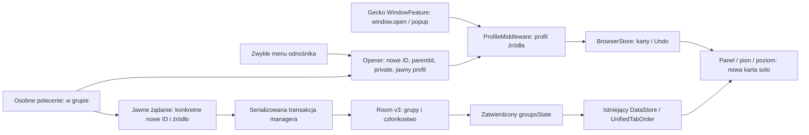

# Zavro x MPV v1161 — otwieranie kart bez niejawnego grupowania

Data: 2026-10-25 Europe/Warsaw. Repo: laszko14/nira-browser. Baza **3075ba7e29c34100a19d499263dfe7a90acebdcd**, v1160 / Draft PR73. Gałąź `fix/zavro-x-mpv-v1161-tab-opening-group-audit`. Jeden autor, bez subagentów i merge. Audyt dotyczył powiązanych ścieżek otwierania/przenoszenia; nie powtarzano pełnych audytów v1159/v1160.

## Przepływ i źródła prawdy

BrowserStore nadal posiada otwarte karty, aktywną kartę, sesję i Undo. Room nadal posiada grupy, członkostwo i pozycje wewnętrzne. DataStore nadal posiada kolejność kontenerów/solo i rozwinięcie. Cache managera to zatwierdzona projekcja. Istniejące pending_root, rekoncyliacja, transakcje/rollback i izolacja kluczy nie są przebudowywane.

`parentId` jest wyłącznie powiązaniem nawigacyjnym. Nie oznacza grupy. selectedTabId nie jest używany do odgadywania rodzica, grupy ani profilu nowej karty.

## Potwierdzone problemy i poprawki

| Priorytet | Dowód i przyczyna | Poprawka |
|---|---|---|
| P1 | RED:10parentowanych linków rozszerzało Sklep z `[before,source,after]` o link1..10. Middleware traktował parentId jako intencję grupowania. | BrowserActions są przepuszczane bez mutacji grup. Tylko oddzielne polecenie „w grupie” wysyła jawne żądanie. |
| P1 | RED: dziecko about:blank po UpdateUrlAction tworzyło grupę z rodzicem. pendingGrouping przechowywał nieuprawniony zamiar. | Usunięto mapę i obsługę opóźnionego grupowania. URL/redirect/select/restore nie uruchamiają grupowania. |
| P0 | RED: parent default/A, aktywnyB → nowe contextId=profile_B. Rzeczywisty WindowFeature156.0.1 przekazuje parentId/private, lecz pomija contextId. | ProfileMiddleware dziedziczy partycję żywego rodzica przy zgodnym private; nie opiera jej na nowszym wyborze profilu. |
| P0 | Kod jawnego menu „w grupie” pomijał private, a TabsUseCases ma domyślne false. contextId=private sam nie ustawia prywatności silnika. | Wspólny opener obu poleceń przekazuje private rodzica i jawny profil. Test menu private sprawdza rzeczywiste content.private, nie samą etykietę. |
| P1 | Opóźniony helper mógł użyć addTabToGroup, które najpierw usuwa członkostwo dziecka z innej grupy. | Jeśli nowa karta ma już grupę, późniejszy jawny intent nie nadpisuje tego ręcznego ruchu. Zamknięte/obce źródło jest odrzucane istniejącymi guardami. |
| P1 | Jawny link z historycznej default grupy miał porównanie null != profile_default, choć oba oznaczają ten sam profil. | Walidację wykonuje istniejące addTabToGroup z kanonicznym sprawdzeniem profilu/prywatności. Bez migracji rekordów. |

Dodatkowo jawny default w menu używa istniejącego sentinela `profile_default`, który ProfileMiddleware zamienia na null przed Gecko. Dzięki temu zamknięcie źródła albo przełączenie aktywnego profilu nie przepisuje normalnego linku do aktywnego prywatnego/nazwanego profilu. Sentinel nie tworzy nowej partycji cookies. Jawne „otwórz prywatnie” z normalnego źródła zachowuje prywatność; nie dziedziczy zwykłego profilu rodzica.

## Zakres reprodukcji i ograniczenia diagnozy

Trzy pierwsze efekty odtworzono deterministycznie RED→GREEN na rzeczywistych BrowserStore/Room i kontrolowanych coroutine scopes. Log RED: `work/v1161-red-confirmed.log`. Test czeka na skończenie mutacji, zamiast sprawdzać stan po jednym runCurrent; wcześniejsza fixture nie czekała na rzeczywiste zakończenie transakcji Room i została poprawiona przed uznaniem wyniku za dowód.

Zwykły kandydat w ContextMenuIntegration v1160 już czyścił parentId, ale pozostałe ścieżki (Gecko/window/image/API) nadal przekazywały rodzica do automatu. Nie udajemy, że odtworzono dokładny wybór etykiety Allegro na telefonie ani konkretną sekwencję samoczynnego wyjęcia źródła z poprzedniej grupy. Potwierdzono mechanizm nieuprawnionych zmian danych; po poprawce zwykłe otwarcie nie wysyła żadnego żądania zmiany grupy. Testy sprawdzają źródło między innymi kartami i wszystkie trzy istniejące grupy bez zmian.

`AppRequestInterceptor.handleCrossDomainLinkInterception` był prywatnym, niewywoływanym helperem z dawnym autogroup. Usunięto ten martwy helper i jego własne extractDomain, zamiast podłączać go do nowego jawnego API. Nie był potwierdzoną przyczyną runtime. Porównanie z bazą potwierdza, że reszta pliku, w tym aktywne onLoadRequest, OAuth, TLS/error, webapp i nira://, jest identyczna. Nie rozszerzano tego wydania o inne zachowania webapp/custom tabs.

## Zmienione odpowiedzialności

- `TabGroupMiddleware`: store-lifetime scope obsługuje wyłącznie jawne prośby. Zwykły ruch nie rozwiązuje nawet lazy Room. Nie ma map pending, delay, observera URL ani selectedTabId inference. Supervisor izoluje awarię pojedynczej prośby; cancellation nie jest połykane.
- `Components`: udostępnia dokładnie tę samą leniwą instancję middleware, którą rejestruje BrowserStore. Nie wymusza inicjalizacji bazy przy budowie Store.
- `OpenLinkInGroupCandidate` / `ContextMenuIntegration`: dwie rozróżnione akcje i wspólny opener. Zwykła zachowuje parentId i nie wywołuje group request; jawna przekazuje faktycznie zwrócone nowe ID, nie selectedTabId. Link obrazu używa uri odnośnika.
- `UnifiedTabGroupManager.groupExplicitlyOpenedLink`: jawna nazwa i guards, istniejąca jedna serializowana transakcja; dodaje dziecko albo tworzy parę wyłącznie na żądanie. Źródło już w grupie nie jest wyjmowane ani przestawiane.
- `ProfileMiddleware`: jawny default i partycja rodzica; prywatne polecenia pozostają odrębne.
- `ComposeTabBarWithProfileSwitcher`: tylko poprawiono przestarzały komentarz. Duplikowanie karty z grupy nadal celowo dodaje duplikat do tej grupy. Duplikat solo pozostaje solo. Przyciski + w grupie i ręczne drag/move nadal są jawnymi działaniami.

## Macierz testów

| Scenariusz | Automatyczny dowód | Telefon |
|---|---|---|
| Link z grupy → solo; źródło między kartami | LinkOpeningTest:10linków,3grupy, wszystkie członkostwa i pozycje źródła bez zmian | NIEURUCHOMIONE |
| Rodzic solo, blank→URL→redirect, zmiana selected | LinkOpeningTest: brak grup, zachowany parentId | NIEURUCHOMIONE |
| Faktyczne polecenie zwykłe, foreground/background semantics | ContextMenuLinkTest: wywołuje akcję SDK candidate/TabsUseCases, sprawdza child ID/parent/private/context i niezmienioną selekcję | NIEURUCHOMIONE |
| Osobne jawne „w grupie” |3kolejne zwykłe +3jawne; tylko jawne ID w tej samej grupie, także private/legacydefault | NIEURUCHOMIONE |
| Gecko window.open / nowe okno | Rzeczywisty WindowFeature156.0.1, mock EngineSession/WindowRequest, źródłoA przy aktywnym private → dzieckoA solo | Prawdziwy Gecko/JS NIEURUCHOMIONE |
| Profile A/B/default/private i zamknięte źródło | Profile + menu tests: źródło lub jawny kontekst, bez nadpisania aktywnym profilem; v1160 matrix A/B/private zachowana | NIEURUCHOMIONE |
|10szybkich/współbieżnych odnośników |16kart łącznie, brak zmian3grup; jawne równoczesne requesty nadal zachowują wszystkie dzieci | NIEURUCHOMIONE |
| Późniejszy ręczny ruch i spóźniona prośba | LinkOpeningTest: dziecko w innej grupie zostaje w niej; closed/foreign source bez skutku | NIEURUCHOMIONE |
| Close/Undo i ręczne przeniesienie nowej karty | Rzeczywiste TabsUseCases + UndoMiddleware + Room: to samoID/parent, solo po Undo, add/remove grupy działa | Snackbar/dotyk NIEURUCHOMIONE |
| Restart i partial restore | Rzeczywisty plik DataStore close/reopen + reload managera: dokładny primaryOrder,3grupy/zwinięcie/pozycja source; zachowane v1160 testy dyskowego Room v3 | Restart procesu/instalacja NIEURUCHOMIONE |
| Panel, pion/poziom, liczniki, obrót | Wspólna projekcja solo/grup, dotychczasowe NativeStrip/ManualGroups/MediaButtonLayout tests i10hashy v1160 | Compose/gesty/obrót Android NIEURUCHOMIONE |
| Room na Androidzie | Rozszerzony TabGroupRoomDeviceTest:10parentowanych blank/URL i nienaruszona baza | Skompilowany; wykonanie NIEURUCHOMIONE |

Native EngineAction.LoadUrl jest w testach menu rejestrowaną granicą, a nie rzeczywistą siecią/Gecko. Test sprawdza, że polecenia wskazują nowe ID i nie ładują źródła. Mock przygotowanego EngineSession w WindowFeature nie jest uruchomieniem GeckoView. Fizycznego urządzenia/emulatora brak (`adb devices` puste).

## Walidacja, review i ochrona danych

Kotlin/JUnit **244/244**, failure/error/skip0:235dotychczasowych +9nowych. JS **163/163** (dotychczasowe162 + kontrola10plików v1160). Lua **77/77** (17bridge+15client+33DRC/DE+12environment). DSP **28/28** (13+15), systemowe FFmpeg. Zachowano testy MPV/audio/Lua. Celowane logi: `work/v1161-targeted-green.log` (pojedyncza fixture porównywała niekanoniczną kolejność metadanych po reload), skorygowany test trwałości PASS `work/v1161-persistence-green.log`. Kolejność logiczna jest sprawdzana dokładnie w DataStore; dane grup po ID, bo kolejność listy metadanych nie jest źródłem porządku UI.

Końcowa komenda: `testDebugUnitTest lintDebug assembleDebug compileDebugAndroidTestKotlin --offline --console=plain --max-workers=1`; log `work/v1161-final-gradle.log`. Końcowy **BUILD SUCCESSFUL4m35s**: BUILD/TEST/LINT/compileAndroidTest PASS. Kompilacja AndroidTest nie jest wykonaniem. Delta lint: **0nowych i0usuniętych**, dokładnie te same1462Fatal/258Error/444Warning/19Hint co w v1160; porównanie id/severity/message/file niezależne od numerów linii. Wynik: `work/v1161-lint-delta.json`. Nie uruchamiano kolejnego pełnego builda po tym poprawnym końcowym przebiegu. Lint ma historyczne abortOnError=false, więc PASS zadania nie oznacza czystego raportu. Bazowy raport: `work/v1160-lint-baseline.xml`.

Review autora: wszystkie wywołania create/add/group w powiązanych ścieżkach, jawny callback, nowy ID zamiast selection, brak URL replay, kolejność blokad i Room commit, aktualne członkostwo dziecka, zamknięte/przeniesione źródło, prywatność i explicitdefault, lifecycle scope bez UI refs i lazy startup. Bez niezależnego recenzenta/subagentów.

Nie zmieniono schematu Room3, kluczy/nazw DataStore, preferencji, Undo retencji, pending_root i nie ma migracji/resetu. Zachowano wszystkie92hashkontrole MPV/v1158 wraz z odwracalnymi wyjątkami UI v1160. Dodano10dokładnych hashy plików FAB/panelu/VM/order/native strip/toolbar względem v1160. Trace MPV zmienia tylko2etykiety wersji. Zero zmian libmpv/Lua/43slotów/DRC/DE/EQ/Ambient/DSP/audiofocus/TLS/GeckoAUTO/HLS/blob/MSE/SurfaceView/mini/fullscreen. Bez Auto Audio i dodatkowych komend medialnych. Brak fizycznego pomiaru START_FILE/obrazu/audio.

## Wydanie

Gradle161, ARM641161, name `0.5.22-alpha67-mpv35`, package `com.prirai.android.nira.mpv`, ABI `arm64-v8a`. Cert SHA256 `df90b01217fbbf973b65865be64bfede267e17fec611c355b814585dfba83f00`. Artefakt `zavro-x-mpv-arm64-v1161`, stały klucz GitHub Secrets i istniejący verifier przed uploadem. APK nie jest pobierany do Codex.

Draft PR ma bazować na `fix/zavro-x-mpv-v1160-multigroup-fab-layout`, bez merge. Dokładny finalny SHA/PR/run i istniejący artefakt zostaną potwierdzone w końcowym opisie PR jako aneks tego handoff po CI; nie uruchamia się dodatkowego CI tylko na metadane dostępne po commit/push. Zgodne package/certyfikat i rosnący code umożliwiają aktualizację v1160 bez odinstalowania/czyszczenia danych. Fizycznej instalacji upgrade nie wykonano.

## Krótki test telefonu — do wykonania

1. Aktualizacja na v1160 bez kasowania danych. Sprawdzić stare3grupy i ich kolejność.
2. W środkowej karcie Sklepu przytrzymać odnośnik → zwykłe „Otwórz odnośnik w nowej karcie”. Nowa ma być w Bez grupy, source w tym samym miejscu. Powtórzyć10razy i porównać wszystkie paski/panel/liczniki.
3. Rodzic solo, link z redirect/about:blank i strona z window.open. Obie karty pozostają solo. Nowa karta z menu również solo.
4. Osobne „Otwórz w nowej karcie w grupie” ma grupować świadomie; zwykłe nie. Powtórzyć w private i A/B po szybkim przełączeniu.
5. Ręcznie przenieść nową kartę do grupy, między grupami i do Bez grupy. Utworzyć drugą/trzecią grupę jak w v1160. Zamknąć/Undo, zwinąć grupę, obrócić ekran, ponownie uruchomić aplikację.
6. Sprawdzić przycisk pobierania nad dolnymi kartami oraz MPV mini→fullscreen→mini: bez restartu filmu/drugiego audio/dodatkowego START_FILE; zachowane Lua/DSP/ustawienia.

Dalsze działania bez automatycznej następnej wersji: fizyczna macierz Allegro/JS/Gecko i instalacji upgrade; w razie utrzymania objawu zebrać dokładny tytuł polecenia i bezpieczną sekwencję działań. Brak podstaw do kolejnej przebudowy systemu kolejności.
