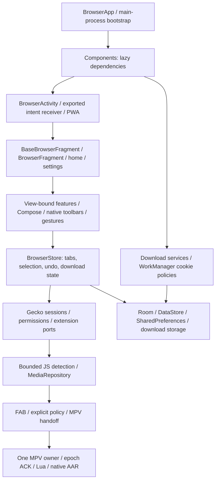

# Zavro x MPV v1162 — audyt aplikacji i niezawodność

Data: 2026-10-26 Europe/Warsaw. Repozytorium: laszko14/nira-browser. Baza **a3fa1232265348cb3ac3405c6e56594a6634a3b0** / v1161 / Draft PR74. Gałąź `fix/zavro-x-mpv-v1162-app-wide-reliability-audit`. Przed pracą sprawdzono local HEAD/status, wersjonowane remote refs, ostatnio aktualizowane PR i CI40241236669 SUCCESS; nie znaleziono nowszej wersjonowanej poprawki. Jeden autor, bez subagentów i merge.

## Zakres i uczciwe granice

[Inwentarz](ZAVRO_X_MPV_V1162_INVENTORY.md) obejmuje 309 plików aplikacji, 14 aktywności, cztery usługi, siedem XML ustawień z 76 kluczami oraz dynamiczne obszary Compose/MPV. Jeden moduł Gradle `:app`; 11 JS i dwa Lua. Gecko/Rust/libmpv są zależnościami AAR/JNI; w app nie ma własnych źródeł C/C++. Nie przeprowadzono audytu wnętrza wszystkich zewnętrznych binariów.

Audyt był przekrojowym przeglądem aktywnych wejść, stanów, źródeł danych, granic i regresji wszystkich obszarów A–K. Katalog wszystkich komponentów nie jest dowodem wykonania każdego ekranu/ustawienia. Nie wykonano pełnej macierzy stanów UI ani testów Nothing Phone(1), GPU, ANR, RSS, FPS czy baterii: brak urządzenia/emulatora. Hostowe MotionEvent, SQLite, animatory i kontrolowane callbacki są testami programowymi, nie fizycznymi gestami ani prawdziwym Gecko/MPV.

Otwarte karty/aktywna karta/Undo nadal należą do BrowserStore; grupy/członkostwo/pozycje wewnętrzne do Room; kolejność kontenerów/solo do DataStore. Nie dodano nowego systemu kart ani migracji. v1161 pozostaje kontraktem: zwykły odnośnik solo; grupa wyłącznie przez jawne polecenie.

## Wykryte i naprawione: 12 usterek

Dwa P0, siedem P1, trzy P2. Osiem efektów odtworzono RED→GREEN; pozostałe mają dowód konkretnego przepływu kodu i regresję, z ograniczeniem pełnego ekranu Home opisanym poniżej. Nie zaliczano samych hipotez ani historycznych lint do nowych potwierdzonych błędów.

| ID / priorytet | Warunki, dowód i przyczyna | Minimalna poprawka / weryfikacja |
|---|---|---|
| A01 P0 — poufne dane w logach | RED rzeczywistego interceptora FxA: syntetyczny `code` z query znalazł się w ShadowLog. FaviconImage i cookie worker również interpolowały adresy/origin, a wyjątki mogły zawierać URL. | Logi własne w tych trzech granicach zapisują kod/typ błędu lub flagę, bez rawURL i pełnego wyjątku. Delegowanie OAuth, pobieranie favicon i clearing bez zmiany intencji. AppBoundariesTest + uzupełniająca kontrola JS. Nie deklarujemy pełnej kontroli logów wewnętrznych zewnętrznych SDK/native na urządzeniu. |
| A02 P0 — LRU między profilami | RED: źródłoA → offset wybrał `foreign` z B zamiast `otherA`. Globalne LRU filtrowano tylko po private, pomijając contextId. Dotyczy obu handlerów toolbaru. | Historia jest filtrowana do tego samego profilu/prywatności przed wyborem; legacy default kanonizowane. Nie zmieniono zapisanego formatu LRU ani jawnej kolejności kart. Test wywołuje rzeczywisty getDestination handlera. |
| A03 P1 — opóźniona animacja nadpisuje nowszy stan | doOnEnd wybierał zapamiętany cel po zmianie selekcji/profilu lub zakończeniu Activity. Kod nie sprawdzał aktualności źródła/celu. | Capture źródła gestu; walidacja ID, selekcji, scope, żywego celu i isFinishing/isDestroyed przed select/navigation. Dwa testy rzeczywistego animatora zachowują nowszą selekcję B lub źródło po finish. |
| A04 P2 — CANCEL zatwierdza gest | RED: ACTION_CANCEL wywołał onSwipeFinished i licznik commit wzrósł do1. To mogło otworzyć panel/przełączyć kartę. | Osobny onSwipeCancelled, rollback preview przez istniejącą animację; własne UP/CANCEL są konsumowane. Native MotionEvent test: cancel bez commit, kolejny slowUP dokładnie jeden commit. |
| A05 P2 — wolny gest Home pozostaje niedokończony | Samodzielny detector Home kończył gest wyłącznie w onFling. SlowUP/cancel nie czyściły stanu i po slowUP handledInitialScroll nie wracało do false przy kolejnym DOWN. | Jawne zakończenie slowUP/cancel i reset na DOWN; po onFling listener jest już zerowany, więc brak drugiego finish. Przegląd kodu i test wspólnego kontraktu MotionEvent; pełny ComposeHome na urządzeniu NIEURUCHOMIONY. |
| A06 P1 — fałszywy sukces cookie clearing | RED: clearData wywołał onError, a savedAt zmienił się z123 na bieżący czas. API jest asynchroniczne; brak await i obsługi callbacków. | Czekanie na pojedynczy onSuccess/onError, CancellationException propagowane, retry po błędach. Stamp tylko po ACK. Kontrolowane callbacki + rzeczywisty Room sprawdzają błąd i late-success po anulowaniu. |
| A07 P1 — stary sweep nadpisuje nowszą politykę | Bezwarunkowy UPDATE po długim clearData mógł przesunąć stamp ustawienia zmienionego w międzyczasie. | CAS UPDATE po origin+expectedStamp+expectedHours. Test edytuje politykę podczas oczekiwania na ACK; nowy rekord pozostaje identyczny. Schemat tabeli bez zmian. |
| A08 P2 — niepotrzebne inicjowanie Gecko | RED: pusty zbiór polityk uruchomił engineProvider1raz, mimo braku czyszczenia. | Lazy engine dopiero dla należnego, poprawnego hosta; dostęp do engine/clearData na Main. Test mierzy liczbę wywołań provider:1→0 dla pustej listy. Brak pomiaru ms/RAM/FPS. |
| A09 P1 — złe bajty z odpowiedzi206 | RED: część4–7 przyjęła odpowiedź Content-Range0–3 o tej samej długości i zapisała dane. Sama długość nie potwierdza zakresu. | Weryfikacja206, dokładnego początku/końca/total przed dotknięciem części; response zamykany również po błędzie. Test rzeczywistego pliku i kontrolowanej odpowiedzi odrzuca błędny zakres; poprawny resume i truncation sprawdzone. |
| A10 P1 — uszkodzona część uznawana za kompletną | RED: oversized part został obcięty i zaakceptowany bez jednego fetch; brak dowodu poprawności jego prefiksu. | Nadmiarowy plik części zerowany i pobierany ponownie. Test sprawdza jeden fetch i dokładną treść bajtową, nie samą długość. Dotyczy tylko prywatnych części pobrania, nie gotowych plików użytkownika. |
| A11 P1 — wyścigi pauza/resume/cancel | IO finally usuwało po samym ID wpis nowego joba; mapa Main/IO bez ochrony. Cancel usuwał sidecar przed końcem zapisu. | Mały DownloadTaskRegistry: tożsamość właściciela, rejestracja przed start, bariery poprzedników i join przed resume/delete. Inne download ID nadal równoległe. Stop/status cleanup po zamknięciu starego I/O; idle na Main z ponownym sprawdzeniem i stopSelfResult(startId). Cztery deterministyczne testy, w tym cancel queued owner przed pierwszym dispatch. |
| A12 P1 — niewłaściwe schematy eksportowanego PWA | RED: extractUrlFromIntent przyjął javascript:alert(1). Ten sam wynik kierowano do tworzenia/ładowania sesji. Nie wykonano exploit/testu wycieku plików. | Tylko HTTP(S) z hostem; walidowane extra, manifest i data. Zachowano priorytet źródeł, query, HTTP localhost i międzynarodowy host. Test rzeczywistego extractora odrzuca javascript/file/content/data/relative/missinghost, przyjmuje poprawne URL. |

Oryginalne objawy RED: `work/v1162-red-confirmed.log`, poprawna fixture callbacku `work/v1162-red-cookie-ack.log`, PWA `work/v1162-red-webapp.log`. Pierwsza fixture mockito używała Java any dla nienullowych callbacków i została skorygowana przed uznaniem błędu cookies za dowód. Test FxA deleguje do kontrolowanego interceptora Deny, bez sieci i prawdziwego konta.

## Pokrycie całej aplikacji A–K

| Obszar | Sprawdzone źródła/kontrakty i wynik | Ograniczenie |
|---|---|---|
| A Architektura | Manifest, moduł Gradle, Components lazy/store middleware, BrowserApp bootstrap, Room/DataStore/SharedPrefs, export/import, AAR/JNI boundary. A06/A07/A11 naprawiają niespójność warstw. | Nie audytowano całego źródła zewnętrznych Gecko/Rust/libmpv binariów. |
| B UI/UX | Aktywności/settings catalog, native/Compose toolbar, popup/FAB i wspólne insets; zachowane10hashy v1160 + NativeStrip/MediaButtonLayout. A03–A05. | Wszystkie kombinacje ekranów, motywów, orientacji, hitboxów/z-index i IME wymagają telefonu. |
| C Karty/grupy | v1161 normal/explicit open, profile/private, Room rollback, order persistence/partialrestore, closeUndo, panel/drop i wiele grup — istniejące regresje zachowane. A02/A03 domykają gesty poza paskami. | Fizyczne drag obu paneli i proces restore nieuruchomione. |
| D Gesty | SwipeGestureLayout, Toolbar/Home handlers, edge opening, cancel/slowUP/fling, native gesture tests. MPV i pull-to-refresh tor bez zmian. | Konflikty z systemowymi gestami, Gecko requestDisallowInterceptTouchEvent i wielodotykiem wymagają urządzenia. |
| E Gecko/WWW | WindowFeature156, context menu, intent/PWA, OAuth interceptor, permissions/fullscreen/view lifecycle i errors. A01/A02/A12. | Rzeczywiste strony/formularze/klawiatura/FIDO2/permissions/network changes nieuruchomione. |
| F Detektor wideo | JS DOM/webRequest/manifest/iframe/blob-MSE, bounded MAX_ITEMS/MAX_VIDEOS/MAX_SCRIPTS, coalesced scan, session/document identity i MediaRepository; wszystkie regresje JS i integralność. | Skuteczności na nowych serwisach i kosztów skanowania nie zmierzono; niczego nie osłabiano/nie dodano kolejnych skanerów. |
| G MPV | Owner/epoch/ACK/timeouts/rollback/release, handoff AUTO/WEB/EXTERNAL, Lua consent/import/slots/DRC/DE, mini/fullscreen. Chronione pliki i istniejące JUnit/JS/Lua/DSP bez zmian. | Brak realnego audio/wideo/GPU/START_FILE/TLS-device. Nie obchodzono DRM. |
| H Wydajność/pamięć | Lifecycle scopes/startup queue, download jobs/map/IO i cookie worker. Uniknięto engine-init i usuwania sidecar na Main przed końcem I/O. | Bez pomiarów FPS/RSS/ANR/CPU/baterii i bez liczbowych obietnic wydajności. |
| I Lifecycle/dane | Main-process/Activity destroy/trim, view-bound features, coroutine callbacks, downloader cancellation, cookies cancellation/CAS, restore/order. A03/A06/A07/A11. | Ubicie procesu, recents, offline/lowmemory/network swap wymagają Androida. |
| J Bezpieczeństwo | Exported intents/PWA, URL/logging, permission boundaries, ZIP allowlist/limity/duplicate checks, backup constraints i media trust/ACK. A01/A12. | Logi zewnętrznych SDK i realne credentialed downloads/profile isolation wymagają weryfikacji urządzeniowej. |
| K Ustawienia |76kluczy XML rozwiązanych do defaults, Kotlin references i dynamiczne UserPreferences/Compose/MPV; import/undo/slot/value tests. A06–A08 naprawiają faktyczne stosowanie retencji. | Nie deklarujemy wykonania każdej opcji ani nie nazywamy martwą opcji wyłącznie po zero grep refs. Pełna macierz interakcji ręczna. |

## Testy i weryfikacja końcowa

Nowe17 JUnit: AppBoundaries5, DownloadCookie7, DownloadOwnership4, WebAppLaunch1. Pełny JUnit **261/261**, failures/errors/skips0 (244z v1161 +17). Pełny Gradle `testDebugUnitTest lintDebug assembleDebug compileDebugAndroidTestKotlin --offline --console=plain --max-workers=1` zakończony **BUILD SUCCESSFUL4m11s**. Szczegółowy lint ujawnił tylko nowy UseKtx w PWA; zastąpiono Uri.parse równoważnym toUri. Po tej zmianie uruchomiono celowany WebAppLaunchTest + lint/assemble/compileAndroidTest, bez zbędnego powtarzania niezmienionych testów pozostałych modułów. Końcowy przebieg po UseKtx: **BUILD SUCCESSFUL3m53s**, PWA1/1 PASS, lint/assemble/compileAndroidTest PASS. Pełny zestaw261/261 poprzedza równoważną zmianę API toUri; CI ponownie wykona cały zestaw na finalnym SHA. Finalna delta lint: **0nowych/0usuniętych**,1462Fatal/258Error/444Warning/19Hint, `work/v1162-reviewed-lint-delta.json`.

JS **164/164**; Lua **77/77** (17+15+33+12), DSP **28/28** (13+15) systemowe FFmpeg. Logi: `work/v1162-js.log`, `work/v1162-lua-dsp.log`, `work/v1162-final-gradle.log`, `work/v1162-reviewed-gradle.log`. Testy natywnego AndroidTest kompilowane; wykonanie NIEURUCHOMIONE (`adb devices` puste). Nie pobierano APK z GitHub do Codex.

Lint w projekcie ma historyczne abortOnError=false. PASS zadania nie oznacza czystego raportu. Bazowy v1161:1462Fatal/258Error/444Warning/19Hint. Nowe naruszenia są porównywane po id/severity/message/file, niezależnie od numeru linii, w `work/v1162-lint-delta.json`. Nie robiono ogólnorepozytoryjnego czyszczenia tłumaczeń ani osłabiania reguł.

Review autora objął wszystkie zmiany: profil i ID w wyborze LRU, moment zatwierdzenia animacji, rozróżnienie CANCEL/UP/fling, właścicieli I/O i queued cancellation, callbacki/duplikaty/cancel/CAS, walidację HTTP i byte output, intent URL i zachowanie poprawnych adresów, prywatność logów, schematy i formaty preferencji. Bez niezależnego recenzenta i subagentów. Nie dopisywano konkurencyjnych animatorów do toolbaru; cancel wykorzystuje istniejący rollback preview.

## Dane, ochrona funkcji, rollback

- Package `com.prirai.android.nira.mpv`, odrębna instalacja od stabilnej Zavro. Stały cert SHA256 `df90b01217fbbf973b65865be64bfede267e17fec611c355b814585dfba83f00`.
- Gradle162, ARM641162, versionName `0.5.22-alpha68-mpv36`, ABI wyłącznie arm64-v8a, artefakt `zavro-x-mpv-arm64-v1162`.
- Brak zmian schematów Room grupv3/cookiesv1, nazw/kluczy DataStore i preferencji, migracji, resetów i porządkowania historycznych grup. Bieżące dane pozostają; wadliwe historyczne grupowania nie są naprawiane według domysłów.
- Zachowano92hashkontrole MPV/v1158 z dokładnymi odwracalnymi wyjątkami UI v1160 oraz10hashy FAB/panelu/VM/order/native strip/toolbar z v1160. MPV trace zmienia wyłącznie dwie etykiety wersji. Bridge, 43sloty, DRC/DE/EQ/Ambient/Lua, HLS/blob/MSE→HLS/ACK, engine/surface/TLS/CA/DRM/audiofocus/mini-fullscreen są funkcjonalnie bez zmian. Bez Auto Audio.
- Rollback kodu jest możliwy przez odwrócenie tego commita na nowej gałęzi i wydanie poprawki z wyższym versionCode oraz tym samym certyfikatem. Android zwykle nie pozwala instalować APK z niższym code w miejscu; nie zaleca się odinstalowania/czyszczenia danych ani obiecuje prostego downgrade.
- Dokładny końcowy SHA, Draft PR, run, status podpisania i istniejący artefakt są potwierdzane po CI w opisie PR jako aneks handoff; nie tworzy się dodatkowego commita/CI wyłącznie na metadane dostępne po push. PR bazuje na gałęzi v1161, bez merge. Instaluje się jako aktualizację v1161 bez kasowania danych.

## Pozostałe ryzyka i dalsze prace

Nie są przedstawiane jako naprawione albo jako potwierdzone incydenty:

1. Kontynuacja pobierania przy recents/task removal i ubiciu procesu: istniejący BrowserActivity celowo zabija proces przy zamknięciu zadania. Nie zmieniano uzgodnionej semantyki wyłączania medialnych usług bez pomiaru/testu Androida; sprawdzić pobieranie po restarcie usługi.
2. Zmieniona treść pod tym samym URL przy wznowieniu: walidacja Content-Range/długości nie zastępuje ETag/If-Range ani kryptograficznej kontroli wersji treści. Dalsze prace wymagają kontrolowanego serwera i testów kompatybilności/cookies, nie automatycznego ignorowania poprawnych serwerów.
3. CookiePolicyDatabasev1 ma historyczny destructive fallback. Nie wyzwala się przy niezmienionym schemacie tej aktualizacji; przed zmianą wersji należy usunąć założenie „polityki można utracić” i przygotować migrację/test upgrade.
4. Polityki cookies są zapisane per origin, bez profileId. Nie deklarujemy oddzielnego scope czyszczenia per profil; zmiana modelu wymaga osobnej decyzji i migracji. Nie rozszerzano samoczynnie zakresu usuwania danych.
5. Legacy/global SDK logging, logcat Rust/Gecko, credentialed downloads i wszystkie uprawnienia/cookies na rzeczywistym urządzeniu wymagają testu. Własne zidentyfikowane logi z URL usunięto, a structured MPV diagnostics zachowały regresje prywatności.
6. Historyczne tłumaczenia/lint, rzadkie wielodotykowe/null-start sekwencje i kompletny stan każdej opcji/motywu/ekranu są dalszą macierzą QA. Nie wykonywano spekulacyjnych refaktoryzacji.

Nie uruchamiać automatycznie następnej wersji. Następny krok to wynik telefonu, potem priorytetyzacja potwierdzonych dalszych usterek.

## Checklista Nothing Phone(1) — NIEURUCHOMIONE

1. Zainstalować aktualizację bez odinstalowania/czyszczenia. Sprawdzić stare profile, grupy/sloty/kolejność, sesję, ustawienia i prywatne skrypty.
2. A→B→private→A, gesty toolbaru/Home w obu kierunkach, cancel/system Back, wolne i szybkie powtórzenia. Nie może wybrać obcego profilu ani zatwierdzić po otwarciu innej Activity.
3. Lewy/prawy panel przy scrollu WWW, pull-to-refresh, resize, drag grup/kart, edge cancel, landscape/portrait, IME/insets. FAB nad kartami; klik ostatnich kart i zamykania.
4.10zwykłych odnośników z karty w Sklepie → Bez grupy; źródło i3grupy bez zmian. Osobne „w grupie”, ręczny transfer, close/Undo i restart.
5. Duże pobranie: pause/resume/cancel w szybkiej sekwencji, dwa pobrania jednocześnie, utrata sieci, powrót z tła, task removal i restart. Sprawdzić finalne bajty/hash APK oraz brak odrodzonego zapisu po cancel.
6. Ustawienie retencji cookies: sukces, błąd i późniejsza edycja; restart. Polityka globalna per origin, nie zakładać odrębności profilu. PWA poprawneHTTP(S)/IDN i odrzucenie nonweb intent; FxA login działa, a raport nie ujawnia URL/query.
7. Ustawienia motywu, pasków, JS/search/privacy/addons/permissions: zmiana→zastosowanie→obrót→restart. Testować ustawienia pojedynczo i kilka istotnych kombinacji, nie resetować danych dla wygody.
8. Detektor przed Play, iframe/HLS/blob/MSE; jeden film AUTO→MPV, fullscreen→mini→fullscreen, prędkość/pozycja/napisy/audio/Lua/DRC/DE/Ambient. Bez drugiego audio, restartu filmu i dodatkowego START_FILE. Testować słuchowo/wizualnie; testy hosta tego nie dowodzą.
