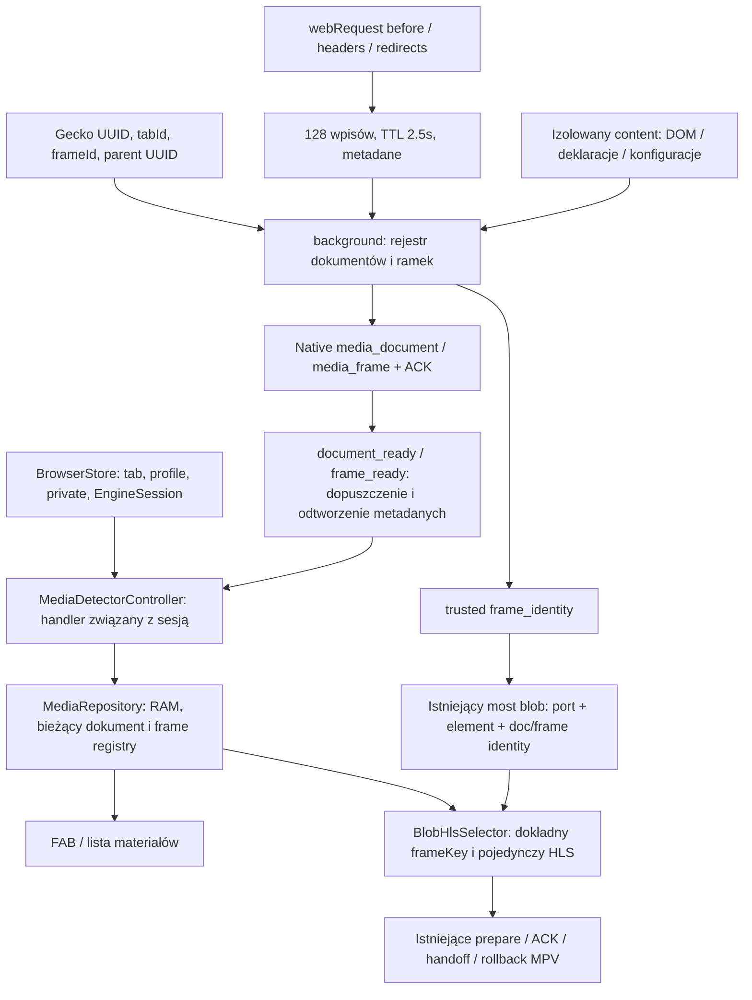

# Zavro x MPV v1164 — Advanced Video Discovery

## Stan wydania

Gałąź `feat/zavro-x-mpv-v1164-gecko-advanced-discovery`, baza v1163 `1c5ae61d59e59ff973a249adff76ed9d704dafda`, bez merge. Parametry: Gradle164, ARM641164, `0.5.22-alpha70-mpv38`, pakiet `com.prirai.android.nira.mpv`. Certyfikat wymagany: `df90b01217fbbf973b65865be64bfede267e17fec611c355b814585dfba83f00`.

Stan przed końcowym PR: lokalna walidacja zaliczona, rzeczywisty Gecko18 scenariuszy w CI40314069715 W TOKU. Podpisany APK jeszcze niepotwierdzony. Ostateczne SHA/PR/CI/artefakt należy potwierdzić w aneksie PR po wykonaniu podpisującego workflow; nie traktować poprzedniego artefaktu v1163 jako v1164.

## Architektura i granice zaufania

BrowserStore i konkretny EngineSession pozostają źródłem powiązania karty/profilu/prywatności. Background mintuje licznik documentKey/frameKey; UUID i relacja rodzica pochodzą z Gecko, nie z treści wiadomości strony. NativeMessaging samo nie dostarcza zaufanego frameId, dlatego dodano zgodny opt-in frameTracking i zdarzenia media_frame przed kandydatami. Rejestr jest ulotny; Room/DataStore nie uczestniczą w detekcji i nie zmieniono ich schematów.

## Potwierdzone problemy i poprawki

Brak potwierdzonego P0. Dziesięć grup problemów P1/P2 poniżej potwierdzono kodem oraz testem; nie oznacza to dziesięciu zgłoszonych incydentów z telefonu.

| Priorytet | Objaw i przyczyna | Minimalna poprawka / dowód |
|---|---|---|
| P1 | Odpowiedź przed document/frame registration ginie; stary routing nie zna właściciela | Krótki bufor metadanych z UUID/tab/frame/private/kontekstem, dopasowanie dopiero po Native ACK. Frozen B baseline10/21→21/21; C7/12→12/12 |
| P1 | srcdoc/about URL ramki odrzucany przez Kotlin, brak potwierdzonego rodzica | Dokładne about:blank/srcdoc tylko w frameUrl, getFrame+parentUUID, zgodna rejestracja natywna. srcdoc realGecko RED→GREEN w CI40305856842 |
| P1 | Initial uncommitted blank nie dostaje deklaratywnego content script | Rzeczywisty kod Gecko bug1415539; ograniczone getAllFrames + isolated executeScript własnego content.js w dowiedzionej ramce, guard przeciw podwójnemu uruchomieniu. Weryfikacja finalna Gecko w toku |
| P1 | SPA bez mutacji nie skanuje; sender.url po History API pozostaje stary | webNavigation history + epoki, potwierdzenie aktualnej trasy przez getFrame i ten sam UUID; hash zachowuje wyniki. Testy kontrolowane oraz realny RED bazowy; finalny Gecko w toku |
| P1 | Spóźniony kandydat ramki może przejść po usunięciu/wymianie | Natywny frame registry z tombstone/high-water, retired frameKey usuwa tylko własne rekordy; root kieruje retire po zniszczeniu child. Kotlin retire/replacement/profile/URL i instrumentacja lifecycle |
| P1 | Root HLS nie ma własnego frameUrl; dwie ramki o tym samym URL są nieodróżnialne dla blob | Root frame0, frameAmbiguous do konserwatywnego starego selektora; nowe oferty blob mają trusted discoveryDocumentKey/frameKey i exact-key selector. Kotlin RED→GREEN +6 JS testów oferty; nie zmieniono ACK/playera |
| P1 | Opóźnione getFrame przy rejestracji SPA nadpisuje nowszy root | Porównanie referencji poprzedniego właściciela po await. Kontrolowany test najpierw RED, potem GREEN; treść źródłowej karty ani jej grupy niezmieniana |
| P2 | dashjs.initialize z jawnym literałem pomijany; poster rodzica gubiony przy sources | Odczyt literalnego drugiego argumentu bez wywoływania playera; dziedziczenie postera wyłącznie relacją źródeł. Frozen B DOM4/5→5/5; pełne przypadki3/5→5/5 |
| P2 | Flood kandydatów konkuruje z limitem Native Messaging |4 równoczesne,128 oczekujących,64 starty/5s, jeden retry/TTL12.5s; anulowanie na pagehide/zmianie epoki. Rzeczywiste produkcyjne callbacki w testach JS; bez deklaracji poprawy FPS/RAM |
| P1 | Spóźniony onBeforeNavigate kasuje nową rejestrację; event podczas enumeracji blank ginie | Guard czasu zdarzenia oraz coalesce jednego oczekującego przeliczenia. Skończone porcje16/limit256; oba wyścigi odtworzone RED→GREEN |

Dwa osobne błędy infrastruktury testowej: Kotlin Activity w custom Java sourceSet nie trafiło do APK (zamienione na Java); nieobsłużony Broken pipe przy oczekiwanym anulowaniu HTTP kończył proces instrumentacji (obsłużono IOException rozłączenia w serwerze, test zachowano). Nie przedstawiać ich jako crashy wydanej aplikacji.

## Testy i pomiary

- Pełny lokalny Gradle `assembleDebug testDebugUnitTest lintDebug compileDebugAndroidTestKotlin`: **PASS,5m42s**. JUnit **272/272**,0fail/error/skip.
- Końcowe spakowanie przejrzanych assetów po dwóch poprawkach JS: incremental assembleDebug **PASS,7s**.
- JavaScript **195/195**, bez wyłączania testów. Trzy stare testy manifestów teraz czekają na asynchroniczną rejestrację, zanim emitują zdarzenie; ich oczekiwane wyniki niezmienione.
- Lua **77/77**:33DRC/DE+17bridge+15custom+12environment; rzeczywisty interpreter Lua z syntetycznym API mp, nie Android.
- DSP **28/28**:15DRC/DE+13audio; rzeczywisty systemowy FFmpeg, bez deklaracji odsłuchu Androida.
- APK verifier: testy pozytywne/negatywne PASS. Certyfikat właściwego wydania sprawdzi osobno podpisujący CI.
- Lint:0nowych,8usuniętych wpisów względem lokalnego raportu v1163 (sygnatura ID/severity/message/path, ignoruje przesunięcia linii). Nadal1462Fatal,258Error,436Warning,19Hint. `abortOnError=false` jest historyczne; PASS zadania nie oznacza czystego repozytorium. Usunięte wpisy dotyczą informacji o wersjach zależności, UseTomlInstead i ABI heurystyki, nie deklarowane naprawy funkcji.
- Stare A:89/89 materiałów,88/88przedPlay,0FP/merge/duplikatów. Nowe B/C i metryki: [raport](ZAVRO_X_MPV_V1164_DISCOVERY_RESULTS.md), [agregaty](V1164_DISCOVERY_METRICS.json).
- Rzeczywisty Gecko156.0.20260921121718/API35/x86_64: baseline10/13, po części poprawek11/13; finalny przebieg18 scenariuszy wymaga wyniku CI40314069715. Testy rzeczywiście używają BrowserApp/GeckoView/WebExtension/Native Messaging/repozytorium, bez mocków tych warstw.
- Fizyczny telefon i publiczne witryny: **NIEURUCHOMIONE**. Nie zastępuje ich Chromium ani emulowany MPV API.

## Code review i ochrona funkcji

Wykonano własny przegląd diff względem dokładnej bazy, kontraktów JS→Native, nieaktualnych wiadomości, limitów, private/profile, protokołu i zakończenia widoku. Dwa dodatkowe wyścigi (await getFrame i utracona enumeracja) naprawiono z testami RED/GREEN. Nie korzystano z subagentów ani niezależnego zewnętrznego review.

Test integralności nadal odtwarza **oryginalne92 hashe v1158** po odwróceniu dokładnie zatwierdzonych hunks v1164, v1163 i wcześniejszych UI. Osobno sprawdza10 plików tab/UI z v1160; nie podmieniono bazowych hashy. W v1164 dotknięto10 chronionych plików wyłącznie w opisanym zakresie detekcji/korelacji, a MpvDebugTrace otrzymał tylko etykiety wersji.

Zachowano silnik libmpv, SurfaceView, Lua43sloty, DRC/DE/EQ/Ambient+, skrypty użytkownika, TLS/AndroidCA, DRM, audiofocus, mini/fullscreen. Most odtwarzania zmieniono wyłącznie o pola discovery identity i odrzucanie nieaktualnej oferty blob; port/element UUID, prepare/ACK/rollback pozostają. Nie dodano START_FILE, odtwarzania/Play w detektorze, nowego downloadera, Auto Audio ani przechwytywania cookies/body/auth.

Karty/grupy/FAB i ich poprawki v1160/v1161 pozostają. Brak migracji Room/DataStore i resetu preferencji. Brak pełnego runtime testu aktualizacji wielu danych na telefonie — zgodność schematów i klucza to osobne dowody od takiego testu.

## Ograniczenia i świadomie zachowane zachowanie

Nie gwarantujemy wykrycia źródła, którego jeszcze nie ma, DRM/Widevine, zasobów dostępnych tylko w obcym kontekście autoryzacji ani arbitralnych blob/data/sandbox ramek. Brak zaufanego właściciela kończy się odrzuceniem. Nie dodano MAIN-world bridge ani match_origin_as_fallback. AUTO w opaque frame nie jest obiecane; fallback wstrzykuje tylko detektor. Stare bezpieczne limity manifestów/GET utrzymano. Nie powiększano limitów dla poprawy procentów.

Dane wydajności to pojedyncze pomiary hosta z narzutem nowej korelacji, nie dowód przyspieszenia telefonu. Dopiero profilowanie na urządzeniu może uzasadnić dalszą optymalizację.

## Nothing Phone(1) —25 scenariuszy, NIEURUCHOMIONE

Zainstalować v1164 jako aktualizację v1163, bez odinstalowania i czyszczenia danych. Przed testem zachować możliwość powrotu do znanego APK; Android może wymagać osobnego planu downgrade, nie obniżać versionCode automatycznie.

1. Dane/ustawienia/grupy po aktualizacji.
2. MP4 przed Play.
3. HLS przed Play.
4. DASH przed Play.
5. Źródło dostępne dopiero po Play.
6. Kilka filmów, poprawne tytuły/postery.
7. Warianty jakości jednego filmu.
8. iframe tej samej domeny.
9. iframe obcej domeny.
10. Zagnieżdżone ramki.
11. about:blank i srcdoc.
12. Dynamiczne video/konfiguracja playera.
13. SPA push/replace i hash.
14. Dwie karty z tym samym adresem.
15. ProfileA/B i prywatny, bez mieszania wyników.
16. Szybka nawigacja/zamknięcie/Undo.
17. Gecko AUTO→MPV dla wiarygodnego blob/HLS.
18. Brak drugiego audio i dodatkowego START_FILE.
19. Mini→fullscreen→mini, pozycja/prędkość/ścieżki.
20. Obrót/klawiatura/tło/powrót.
21. DRC/DE/EQ/Ambient+ i Lua43sloty.
22. Fab/panele/karty/gesty nieprzeszkadzające stronie.
23. Utrata sieci/przekierowanie/wygasły token, zachowany WEB fallback.
24. DRM pozostaje w zgodnym odtwarzaczu WWW, bez obejścia.
25. VIDEO DISCOVERY i Supertest40s bez prywatnych danych.

Dalsze prace po v1164: pomiary na telefonie, opt-in zanonimizowane repro publicznych playerów, ewentualne rozszerzenie opaque AUTO dopiero z pomiarem i bezpiecznym projektem. Nie wdrażać automatycznie kolejnej wersji.
